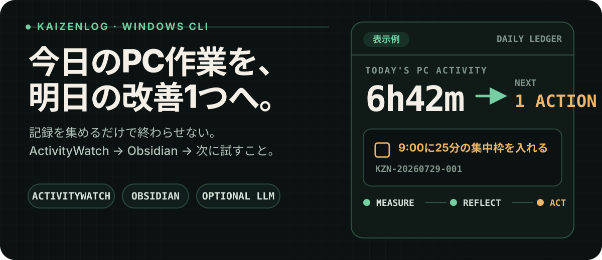
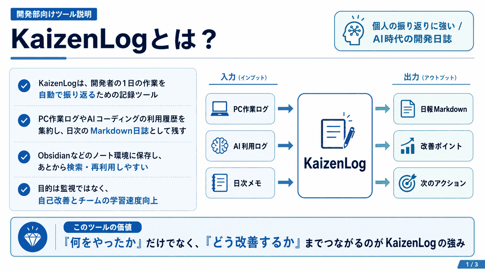
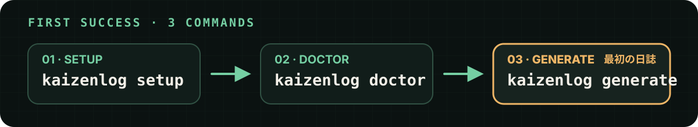
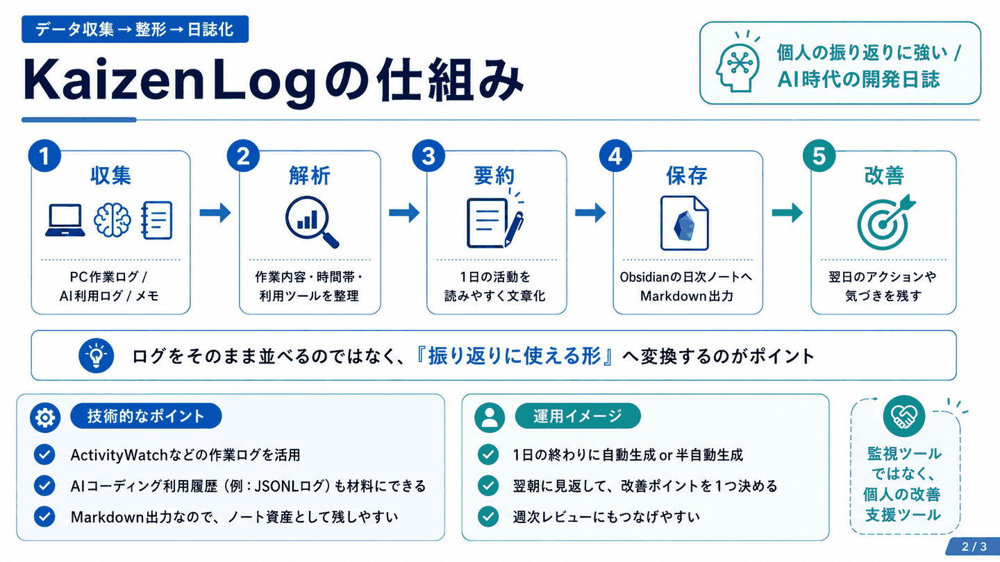
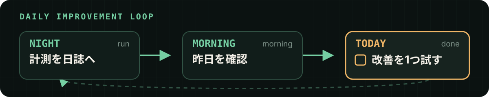
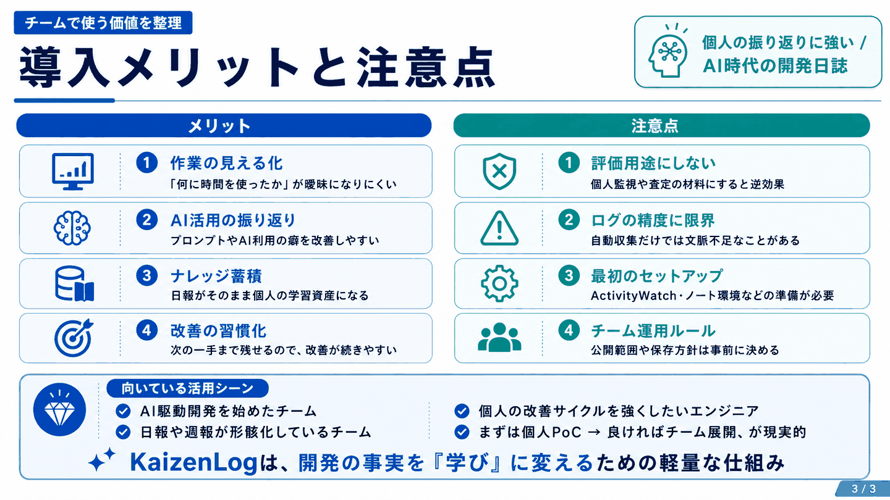

<p align="center">
  
</p>

<h1 align="center">KaizenLog</h1>

<p align="center">
  <b>今日の PC 作業が、毎晩そのまま日誌になる。</b><br>
  PC の作業時間とタイムラインを Markdown の日誌にまとめる Windows 向けツール。<br>
  日誌・日報の下書き・月次集計は LLM なしで作れます。AI による改善提案も追加できます。
</p>

<p align="center">
  
  
  
  
  
  
</p>

<p align="center">
  <a href="#-これは何をするツールか">概要</a> ·
  <a href="#-手に入るもの">手に入るもの</a> ·
  <a href="#-ダウンロードしたものだけで動く">必要なもの</a> ·
  <a href="#-3コマンドで始める">3コマンドで始める</a> ·
  <a href="#-毎日の使い方">毎日の使い方</a> ·
  <a href="#-発展-ai-のやり直しを測って次に活かす">AI改善ループ</a> ·
  <a href="#-llm-とデータの扱い">データの扱い</a> ·
  <a href="docs/USAGE.md">全コマンド</a>
</p>

---

## 🧭 これは何をするツールか

**「今日、何に時間を使ったか」を記録し、日報や翌日の振り返りに使うためのツールです。**
ActivityWatch が記録したアプリ名・ウィンドウタイトル・時間を読み取り、カテゴリ別の作業時間とタイムラインを Markdown ファイルに保存します。操作はターミナルから行います。
保存した日誌は Obsidian で読めます。保存先は通常のフォルダでもよく、Obsidian の起動は生成処理の必須条件ではありません。

| できること | 手に入るもの | 使うコマンド・条件 |
| --- | --- | --- |
| **1日の作業を振り返る** | アプリ・カテゴリごとの時間、時系列の作業日誌 | `generate`。ActivityWatch の記録が必要 |
| **日報の下書きを作る** | 取得できたログからまとめた業務・進捗の下書き | `report --no-llm --write`。生成済みの日誌・統計を利用 |
| **月ごとの時間配分を見る** | 作業のつけ先ごとの時間と、取得できた成果の月次サマリ | `monthly`。工数記録を含む日次統計を利用 |
| **改善を1件ずつ試す** | 改善候補、未完了アクション、実施・指標の記録 | 提案の生成は `advise`（LLM が必要）、確認と完了は `today` / `done` |
| **AIへの依頼を見直す** | 繰り返し依頼やリトライに費やした時間の集計 | `prompts --roi` など。対応する AI セッションログが必要 |

まずは **作業日誌だけ**を作れます。AI による改善提案と、AI 利用ログの分析は、それぞれ必要な入力を用意したときに追加します。

<p align="center">
  
</p>

> 図は全体像です。各機能の必要条件は[ダウンロードと動作条件](#-ダウンロードしたものだけで動く)を参照してください。

---

## ✅ 手に入るもの

`generate` を実行すると、保存先に `01 Daily Notes/YYYY-MM-DD.md` と日次統計が作られます。日誌のフォルダ名は設定で変更できます。
次の例は、**GitHub の公開 ZIP からインストールした CLI に架空の ActivityWatch データを与えて生成したノートの抜粋**です。実際の利用者の作業や改善効果ではありません。

入力は「開発アプリを60分、ブラウザを30分」。入力 watcher と LLM は使っていません。

```markdown
## 📊 Activity Log

**合計アクティブ時間**: 1h30m / コンテキストスイッチ: 1回

### カテゴリ別

| カテゴリ | 時間 | 割合 |
| --- | ---: | ---: |
| 開発 | 1h00m | 67% |
| ブラウジング | 30m | 33% |

## 振り返り

これは検証用の手書きメモです。
```

日報の下書きも欲しい場合は、続けて `report --no-llm --write` を実行します。**ここまで LLM の設定は不要です。**
AI セッションログや Git の成果を取得できない場合、日報に書ける内容もその範囲に限られます。

作成済みの改善アクションがある場合は、翌日のノートにも未完了分を転記します。チェックボックスのある「今日やること」と、指標を追跡する「効果モニタリング」は別枠です。実施の記録と、指標が目標に達したかどうかも分けて扱います。

**手書きは消えません。** 更新するのは管理マーカー区間（`kaizenlog:…`）だけで、その外側の本文はそのまま残ります。
「振り返り」「明日の目標」は本人が書く欄で、自動では書きません。

---

## 📦 ダウンロードしたものだけで動く？

**ソース ZIP からインストールして使えます。日誌生成には、別途 Python・ActivityWatch・保存先の設定が必要です。**
Python の依存ライブラリは `pip install .` で取得します。ActivityWatch、Obsidian、LLM 本体はこのリポジトリに同梱していません。

| 使いたい機能 | 別途必要なもの | 補足 |
| --- | --- | --- |
| CLI の起動 | Python 3.11 以上、Python の依存ライブラリ | Windows は `requests`・`tzdata` とその依存をインストール時に取得 |
| 作業日誌の生成 | 起動中の ActivityWatch と対象日のウィンドウ記録、書き込み可能な保存先フォルダ | 通常は `http://localhost:5600` から取得。導入前の作業を後から記録することはできません |
| Obsidian で日誌を読む | Obsidian アプリ | Markdown の生成・閲覧には通常のフォルダとテキストエディタも使えます |
| 集中ブロック・入力量の表示 | `aw-watcher-input` | 任意。未導入でも作業日誌は作れます |
| ブラウザのサイト別集計 | ActivityWatch の `aw-watcher-web` 拡張 | 任意。後述の AI 会話用拡張とは別です |
| AI による改善提案 | 対応する LLM バックエンド、必要に応じてログイン・API キー・モデル | Claude Code、GitHub Copilot CLI、OpenAI 互換 API に対応 |
| AI 利用ログの分析 | 対応ツールのセッションログ、または同梱の Chrome 拡張で書き出した JSONL | ブラウザ用は `browser-extension/` を手動で読み込みます |
| 毎日の自動実行 | Windows タスクスケジューラへの別途登録 | 手動コマンドでの利用には不要 |

**配布状況（2026-10-15 確認）** — 公開 `main` の `dafbbd1`（`1.5.0rc1`）を検証しました。[GitHub Releases](https://github.com/awano27/KaizenLog-/releases) は未作成です。現在の導入経路はソース ZIP または Git clone です。

- 公開 ZIP から空の Python 3.11 仮想環境へインストールし、CLI 起動、架空データでの日誌生成、LLM なしの日報・月次集計を確認しました。
- 基本の CLI、プロンプト、Claude Code 用スキルは Python パッケージに入ります。`browser-extension/` は Python パッケージに入らないため、ソース ZIP のフォルダを使ってください。
- 公開版ではタスク登録用の `scripts/register-task.ps1` が Python パッケージに入っていません。インストール後の `setup` による自動登録は使えないため、必要な場合はソース ZIP 内のスクリプトを手動で使います（[手順](docs/USAGE.md#step-7-自動実行の登録)）。
- この作業ツリーの追加機能は公開 ZIP と異なります。[未公開の追加機能](#開発中の追加機能公開zipには未反映)を参照してください。

この確認は架空の入力を使った CLI 検証です。実際の ActivityWatch、Obsidian の画面、LLM 接続、Chrome 拡張、タスク登録の動作は今回の確認範囲に含みません。
タスク登録スクリプトの既定の日次処理は `run`（LLM を使用）です。LLM なしで自動実行する場合は、`generate` を呼ぶタスクを別途設定してください。

---

## 🚀 3コマンドで始める

<p align="center">
  
</p>

### 1. ダウンロードしてインストールする

**前提** — Windows 10 / 11、Python 3.11 以上、初回インストール時のインターネット接続。
GitHub の **Code → Download ZIP**、または[ソース ZIP](https://github.com/awano27/KaizenLog-/archive/refs/heads/main.zip)をダウンロードし、展開した `KaizenLog--main` フォルダで PowerShell を開きます。

```powershell
python --version                        # 3.11 以上であることを確認
python -m venv .venv
.\.venv\Scripts\python.exe -m pip install .
.\.venv\Scripts\kaizenlog.exe --help       # インストールと起動を確認
```

仮想環境の有効化や PowerShell の実行ポリシー変更は、この手順では不要です。
Git を使う場合は `git clone https://github.com/awano27/KaizenLog-.git` で取得したフォルダから同じ手順を実行します。
既に [pipx](https://pipx.pypa.io/) を使っている場合は `pipx install .` でも導入できます。

### 2. 保存先と記録を準備する

[ActivityWatch](https://activitywatch.net/) を別途インストールして起動し、`aw-watcher-window` で対象日の作業が記録されていることを確認します。保存先には Obsidian ボールト、または自分で作った日誌用フォルダを指定します。

```powershell
.\.venv\Scripts\kaizenlog.exe setup --skip-task --skip-skills
.\.venv\Scripts\kaizenlog.exe doctor
```

`setup` は保存先・タイムゾーンなどを設定するウィザードです。この例ではタスク登録と Claude Code スキルの配置を省略します。
設定の既定場所は `%APPDATA%\kaizenlog\config.toml` です。
日誌だけで始める場合は、設定の LLM 欄を次の内容にします。

```toml
[llm]
backend = "none"
fallback_to_local = false
```

### 3. 今日の日誌を作る

```powershell
$day = Get-Date -Format 'yyyy-MM-dd'
.\.venv\Scripts\kaizenlog.exe generate --date $day

# 日報の下書きも追記したい場合（LLM 不要）
.\.venv\Scripts\kaizenlog.exe report --date $day --no-llm --write
```

保存先の `01 Daily Notes` で当日の `.md` を開けば、最初の日誌を確認できます。
以降の例の `kaizenlog` は、この仮想環境では `.\.venv\Scripts\kaizenlog.exe` に読み替えてください。

日付なしの `generate` や `run` は追いつき処理を含むことがあるため、**初回は日付付き `generate` を推奨**します。
日付を指定しても、翌日のアクション欄を転記・更新する場合があります。`generate` は指定日のファイルだけに書くコマンドではありません。

---

## 📅 毎日の使い方

`kaizenlog --help` でコマンドを確認できます。まずは `generate`、`report --no-llm`、`today` を使えば、LLM なしで記録・日報・アクション確認を進められます。

**朝に目標を書く → 日中は自動記録 → 夜に日誌を作る → 必要な日だけ AI 提案 → 翌日 `done`。**
AI を使わない日でも、日誌と工数の下書きは作れます。

<p align="center">
  
</p>

> ③ の「要約」はコードによる決定論の集計です。文章での改善提案だけが任意の LLM を使います。

```powershell
# 朝（任意）
kaizenlog goal "提案書の初稿を完成させる @執筆・ノート"
kaizenlog morning --skip-catch-up    # 追いつき処理を省略して朝のノートを更新

# 夜 — 日誌のみ（LLM 不要）
kaizenlog generate --date YYYY-MM-DD
kaizenlog report --date YYYY-MM-DD --no-llm --write  # 日報も欲しい場合

# 夜 — 日誌 + 改善提案（LLM 設定が必要）
kaizenlog run

# アクションの確認・完了
kaizenlog today
kaizenlog done KZN-20260801-001
```

| コマンド | いつ | メモ |
| --- | --- | --- |
| `goal "…"` | 朝 | ノートに今日の目標を書く |
| `morning` | 朝 | 未完了アクションなどを朝のノートに再掲。`--skip-catch-up` は追いつき処理のみ省略 |
| `generate` | 夜 | Activity Log と日次統計を作成（決定論） |
| `report --no-llm --write` | 夜 | 生成済みの記録から日報ドラフトを追記 |
| `run` | 夜 | `generate` のあと `advise`（LLM） |
| `today` / `done` | 随時 | 実行できる候補だけを一覧（効果モニタリングは件数のみ）と完了記録 |

`kaizenlog run` は `generate` と `advise` を順に実行します。
`backend = "none"` の状態で `advise` を呼ぶと、LLM 生成を行わずエラーとして終了します。日誌だけなら `generate` を使ってください。
日々の LLM 提案は1〜3件です。`advise` は本人の振り返りと観測された記録を材料に、翌日試す候補を作ります。
`kaizenlog today` が出すのは実行できる候補だけで、判定済みの指標は `効果モニタリング N件（今日の候補ではありません）` と件数だけ表示されます。観測値が取れない日は達成・未達に丸めず「未判定」と表示します。

### 運用ログと復旧

`kaizenlog status` で実行履歴、`kaizenlog doctor` で接続先や保存先の状態を確認できます。ActivityWatch に接続できない場合は起動状態を、ウィンドウ記録がない場合は `aw-watcher-window` を確認してください。
入力 watcher が無い場合は入力指標を取得できません。LLM の認証や入力 watcher の再起動は、それぞれのツールで行います。

### 開発中の追加機能（公開ZIPには未反映）

<details>
<summary><b>この作業ツリーにある追加実装を見る</b></summary>

以下はローカルの追加実装です。2026-10-15 に確認した公開 `main`（`dafbbd1`）の ZIP には含まれません。

- 引数なしの `kaizenlog` で `today` を表示。通常のヘルプは日常の5コマンドに絞り、`kaizenlog --help --all` で全コマンドを表示。
- `kaizenlog now` で日中の状況を読む、`kaizenlog recall "キーワード"` で過去の記録を検索。
- 日誌に1・3ヶ月前の記録を再掲し、週次・月次に観測に基づく物語とアルバムを追加。
- Grok / Cursor の対応形式のログ読取、ルール管理、依頼文の下書き出力、preflight、guard watch。
- タスク登録スクリプトを Python パッケージに同梱。
- `status` が端末内の運用 ledger を優先し、`doctor` が Claude Code の認証状態と入力 watcher の鮮度を診断。

操作例はローカルの `docs/USAGE.md` に記載しています。追加機能とその操作例は、今後の公開予定です。

</details>

### 手書きは消えない

管理マーカー区間だけを更新し、その外側の手書き本文を置換しません。

```markdown
## 振り返り

午前は執筆に集中できた。午後は会議後の再開に時間がかかった。
```

この外側の本文は置換しません。`advise` を使う日は、`## 振り返り` を本人の文脈として優先します。

<details>
<summary><b>使い方の例（開発者 / 企画・営業 / ライター）</b></summary>

> 数値と文章はすべて架空の例です。実在する利用者のデータ、導入実績、改善効果ではありません。
> 各例のカテゴリ時間は主な内訳であり、合計時間の完全な内訳ではありません。

**1. ソフトウェア開発者**
- 自動記録: 6時間12分｜実装 3時間05分｜レビュー 1時間20分｜会議 50分
- 自分の振り返り（手書き）: 会議後に開発へ戻るまで時間がかかった
- 明日の目標（自分で設定）: 午前中にレビュー対応を終える

**2. 企画・営業**
- 自動記録: 5時間48分｜顧客会議 2時間10分｜提案書 1時間45分｜調査 1時間05分
- 自分の振り返り（手書き）: 会議が続き、提案書の作成が夕方に偏った
- 明日の目標（自分で設定）: 最初の会議までに提案書の骨子を作る

**3. ライター・研究者**
- 自動記録: 5時間30分｜執筆 2時間35分｜調査 1時間50分｜推敲 45分
- 自分の振り返り（手書き）: 午前の調査が長引いたが、午後は執筆に集中できた
- 明日の目標（自分で設定）: 調査を90分で区切り、初稿へ進む

</details>

> **測れる範囲について** — Activity Log は ActivityWatch が観測した PC 前景活動の記録です。生活全体の記録ではなく、勤務時間・目標達成・集中力・生産性を判定するものでもありません。スマートフォン、他デバイス、離席中の行動は既定では測定できません。入力 watcher から統計を取得できる場合は、25分以上入力が続いた区間を「集中ブロック」として表示します。

---

## 🔁 発展: AI のやり直しを測って次に活かす

日誌が安定してからで十分です。
やり直しのムダを測る · 効果の高い依頼方法を見つける · 学んだルールを次の AI へ渡す · 改善効果を実測する — を**同じ計測データ**で見ます。

<p align="center">
  
</p>

```powershell
# 見る
kaizenlog status
kaizenlog prompts --roi

# 教える（まず dry-run）
kaizenlog handoff --dry-run
kaizenlog coach --dry-run

# 効いたか確かめる
kaizenlog abtest new --predict +30 --days 28
kaizenlog abtest status
kaizenlog abtest finish --felt +20
```

| 機能 | ひとこと |
| --- | --- |
| **Loop Tax** | リトライ連鎖のうち、最終試行を除くムダ（時間が主。トークンは取れたときだけ） |
| **Prompt ROI** | 繰り返し依頼の再発と、スキル化後の変化 |
| **handoff** | 実測された教訓をエージェント用コンテキストへ（マーカー範囲のみ再生成） |
| **coach** | 提案ファイル作成。書き込みは `coach --apply <file>` のみ |
| **abtest** | 予測・体感・実測。baseline 不足なら「不成立」（数字を作らない） |

通常の `coach` は提案ファイルと diff を作成します。管理対象の coach 区間へ書き込むのは `coach --apply <proposal-file>` だけです。
取得できないトークンや費用は「不明」のままにします。推定で穴埋めして効果を断定しません。

<details>
<summary><b>その他の補助コマンド</b></summary>

```powershell
kaizenlog rehumanize --days 30          # 過去ノートの機械構文を平文に（既定は差分のみ、--write で反映）
kaizenlog excavate                      # 過去の空転をさかのぼって監査
kaizenlog guard install --write         # セッション中の空転をフックで警告（明示時のみ）
kaizenlog screenpipe-probe --minutes 30 # screenpipe 疎通（有効化時・既定 OFF）
```

</details>

### ブラウザ AI と M365 Copilot

| 状態 | 内容 |
| --- | --- |
| **利用可** | Chrome 拡張で ChatGPT / Claude.ai / Gemini の会話イベントをローカル JSONL へ（詳細は [browser-extension/README.md](browser-extension/README.md)） |
| **Next / Planned** | M365 Copilot 改善アシスト（**現在未実装**） |

M365 Copilot は、会話の自動取得、Microsoft Graph／テナント連携、自動送信、カスタム指示の自動変更にまだ対応していません。
参考: [customize-how-microsoft-365-copilot-responds-to-you](https://learn.microsoft.com/en-us/microsoft-365-copilot/extensibility/customize-how-microsoft-365-copilot-responds-to-you) / [declarative-agent-instructions](https://learn.microsoft.com/en-us/microsoft-365-copilot/extensibility/declarative-agent-instructions)

---

## 🔒 LLM とデータの扱い

集計・分類・Obsidian への保存はローカルです。外部送信の有無は LLM バックエンド次第です。

| `backend` | 送信先 |
| --- | --- |
| `"none"` | 送らない（`advise` はエラー） |
| `"openai-compatible"` | 設定した endpoint（ローカル／リモートどちらもありうる） |
| `"claude-code-cli"` | Claude Code CLI 経由（CLI が接続するサービス） |
| `"copilot-cli"` | GitHub Copilot CLI 経由（CLI が接続するサービス） |

- `openai-compatible` は設定した endpoint へ送信します。endpoint はローカルとは限りません。
- `fallback_to_local=true` で CLI 失敗時だけ OpenAI 互換へ切り替えます。その endpoint が常にローカルとは限りません。
- `[privacy] redact_patterns` は送信直前のベストエフォートな正規表現マスクです。
- `kaizenlog advise --dry-run` でマスク後の送信予定文を確認できます（元ノートは書き換えません）。
- 更新するのは管理マーカー区間だけです。

詳細は [プライバシー](docs/USAGE.md#プライバシーについて) を参照してください。

---

## 💠 向いている使い方と注意点

<p align="center">
  
</p>

> 図は導入検討のための観点整理です。KaizenLog 自体はローカルの個人ツールで、**チーム共有や集計の機能は実装していません**。図中の「チーム運用ルール」は、ノートを共有する場合に人が決めることを指します。

---

## ⚠️ 制限とカスタマイズ

- 測れるのは主に **PC 前景アプリ**です。スマホ・他端末・離席は既定では測りません。
- カテゴリ時間の増減は「集中が良くなった」ではなく、別画面への移行を示すことがあります。
- LLM の提案は事実ではありません。Activity Log と注記を見て判断してください。
- 日誌のタイムラインは抜粋です。短いブロックの多くは「細切れ」にまとまります。

カテゴリは設定で足せます。

```toml
[[categories.rules]]
name = "AI作業"
ai = true
patterns = ["dify", "自社チャットボット"]
```

全コマンド・実験・評価は [docs/USAGE.md](docs/USAGE.md) にあります。

---

## 🛠 開発

```powershell
git clone https://github.com/awano27/KaizenLog-.git
cd KaizenLog-
python -m venv .venv
.\.venv\Scripts\Activate.ps1
pip install -e ".[dev]"
pytest
```

変更履歴は [CHANGELOG.md](CHANGELOG.md)。

## 🗺 ロードマップ

- [x] ActivityWatch から Markdown 日誌
- [x] 改善提案（advise）とアクション転記
- [x] Prompt ROI / handoff / coach / A/B
- [x] Claude Code・Copilot CLI・OpenAI 互換
- [x] ブラウザ AI テレメトリ
- [x] [screenpipe](https://github.com/mediar-ai/screenpipe) 連携（既定 OFF・参考層）
- [ ] M365 Copilot 改善アシスト
- [ ] ローカルの追加機能を配布版へ反映（Grok / Cursor ログ、`now` / `recall`、同梱タスクスクリプトなど）

## 📄 ライセンス

[MIT License](LICENSE)。ActivityWatch は別プロセスとして REST API 経由で使い、同梱しません。
